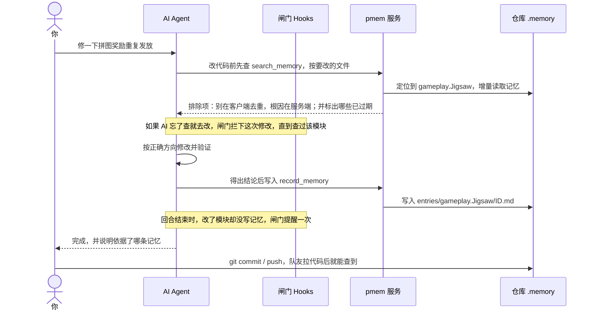

# pmem：挂载式、全自动的本地研发记忆系统

> **绑定一次，之后全自动。** pmem 挂载到 Cursor / Claude Code / Codex 上，通过 Hook（AI 工具调用前后自动执行的脚本）自动触发：
> AI 改代码前**按模块检索**以前的结论，得出结论后**按模块记录**，回合结束时**提醒补记**。
> 记忆是你仓库里的 Markdown 文件，本地运行、随代码提交、团队共享，不需要服务器和数据库，也不上传任何数据。

📖 **图文版使用手册**：[pmem-guide.html](https://mry-ship.github.io/pmem/pmem-guide.html)

## 一眼看懂

| | |
|---|---|
| **是什么** | 挂在 AI 编程工具上的项目记忆插件。按业务模块（如 `gameplay.Jigsaw`）沉淀根因、排除过的方向、方案决定和风险 |
| **解决什么** | AI 每次对话都从零开始、反复踩同一个坑、走回被否掉的方向；经验只在某个人脑子里 |
| **怎么工作** | 改代码前 Hook 自动拦截，要求先查该模块记忆 → AI 按查到的结论修改 → 得出结论时写入记忆 → 回合结束 Hook 提醒补记 → 记忆随代码提交 |
| **存在哪** | 本地仓库的 `.memory/` 目录，一条记忆一个 `.md` 文件；索引是本机缓存，删了可重建 |
| **怎么接入** | 安装 + `pmem init` + 打开 MCP 开关 + 让 AI 划分模块，约 5 分钟，每个项目只做一次 |
| **怎么维护** | 基本零维护。偶尔跑 `pmem doctor` 体检；同一议题碎片多了让 AI 合并 |

### 核心特点

- **挂载式**：不改你的代码，也不改工作方式。`pmem init` 自动生成规则、Hook、MCP 配置，挂到 AI 工具上。
- **自动触发**：改代码前没查过该模块的记忆，Hook 会拦下修改直到查过；改了模块却没写记忆，结束时提醒一次。出任何错误都直接放行，不卡开发。
- **按模块寻址**：改哪个文件，就自动定位到它所属的业务模块去查，不用 AI 猜关键词。
- **本地 + 团队共享**：记忆跟代码在同一个版本库（Git / SVN），队友拉代码就能查到；换电脑、换模型都不丢。
- **不用过期结论**：记忆关联的代码改过或被删了，检索结果会标“需核实”；新结论用 `supersedes` 替代旧结论，不再查到互相矛盾的内容。
- **省 token**：按需检索，每次只返回最相关的几条，记忆再多单次开销也基本不变。

### 三步接入

```bash
# 1. 安装（每人一次）
uv tool install "pmem[embed] @ git+https://github.com/mry-ship/pmem"

# 2. 在项目根目录绑定（每个项目一次）
pmem init --type game          # game / app / backend / generic

# 3. 打开 Cursor 设置 → MCP → 启用 pmem；再对 AI 说“按 pmem-bootstrap 技能划分模块”
pmem doctor                    # 自检通过后，把 .memory/ 和 .cursor/ 提交到版本库
```

团队其他人拉下代码后，只需要安装并打开 MCP 开关。详细步骤见 [5 分钟接入](#5-分钟接入)。

### 后续维护

| 什么时候 | 做什么 |
|---|---|
| 日常开发 | 什么都不用做。不想被打扰时在提问里写“跳过记忆”；结束提醒时没有新结论就回复“无需记录” |
| 提交代码时 | 把 `.memory/` 里新增的记忆一起提交，`pmem doctor` 会提示还有几条没提交 |
| 新增业务模块 | 在 `.memory/modules.yaml` 里加一个模块和它的路径 |
| 同一议题记忆变多 | 对 AI 说“按 pmem-compact 技能合并记忆”，几条碎片合成一条现状 |
| 换个说法搜不到 | 对 AI 说“按 pmem-normalize 技能整理同义词”，登记“闪退 / 崩溃”这类同义叫法 |
| 想看效果 | `pmem report` 看命中率、避坑次数、跨人复用 |
| 升级 pmem | `uv tool upgrade pmem` |

### 效果示例

```text
你：修一下拼图奖励重复发放
Agent：（自动查 gameplay.Jigsaw 的记忆）
       已有排除项：不要在客户端去重，根因是服务端 Claim 没有按关卡做幂等……
       我按这个方向修改服务端，并补测试。
```

---

## 目录

- [为什么需要 pmem](#为什么需要-pmem)
- [pmem 怎么解决](#pmem-怎么解决)
- [一次对话的完整流程](#一次对话的完整流程)
- [收益：实测数据](#收益实测数据)
- [最适合的场景](#最适合的场景)
- [和其他记忆方案比](#和其他记忆方案比)
- [5 分钟接入](#5-分钟接入)
- [日常怎么用](#日常怎么用)
- [命令速查](#命令速查)
- [维护与度量](#维护与度量)
- [配置](#配置)
- [常见问题](#常见问题)
- [已知限制](#已知限制)

---

## 为什么需要 pmem

用 AI 写代码久了，会反复遇到这几件事：

- **每次对话都从零开始。** 上周花两小时查清的根因，这周换个对话 AI 又从头猜一遍，甚至走回已经被否掉的方向。
- **结论只在某个人脑子里。** 张三踩过的坑，李四的 AI 不知道；人一走，经验也跟着走了。
- **手写的 AGENTS.md / 规则文件越写越长。** 每次对话全量加载，哪句已经过时没人知道。
- **工具自带的记忆锁在一台机器、一个工具里。** 换电脑、换工具、换同事就用不上了。
- **旧结论和新结论互相打架。** 记忆只能追加，AI 同时查到两条矛盾的结论，不知道该信哪条。

## pmem 怎么解决

| 设计 | 做法 | 带来的好处 |
|---|---|---|
| **记忆就是仓库里的文件** | 一条记忆一个 `.md`，放在 `.memory/entries/<模块>/` 下 | 随代码提交、评审、回滚；换电脑、换模型、换人都不受影响；项目结论不出公司 |
| **按业务模块寻址** | `modules.yaml` 把多个路径和别名映射到同一个模块 | 改哪个文件，就自动查那个模块的记忆，不用 AI 猜关键词 |
| **改前先查、改后提醒** | Hooks（工具调用前后的拦截脚本）在 AI 漏查时拦下修改，结束时提醒补记 | 不靠 AI 自觉；出任何错误都直接放行，绝不卡住开发 |
| **用前按代码核对** | 记忆关联的代码改过或被删，检索结果标 `stale: true` 并写明原因 | 不会拿过期结论去改代码 |
| **替代而非删除** | 推翻旧结论时新写一条并用 `supersedes` 引用，旧的自动隐藏 | 不再查到互相矛盾的结论，历史仍可按日期回看 |
| **按需检索，不全量加载** | 每次只返回最相关的几条（默认 5 条，上限 10 条） | 记忆再多，单次 token 开销也基本不变 |

### 核心概念

- **模块（module）**：`category.Module`，如 `gameplay.Jigsaw`。模块是业务单元而不是目录，可以包含多个路径、起别名。
- **议题（entity）**：模块内的子话题，如 `Reward`、`Config`。
- **五种记忆类型（kind）**：`conclusion` 结论、`exclusion` 排除项、`correction` 更正、`risk` 风险、`decision` 决定。
- **关联代码（anchors）**：记忆涉及的代码位置（`文件#方法`），用来判断记忆是否过期。
- **别名与同义词**：写记忆时填 `aliases`（如“闪退 / 崩溃 / crash”）；团队常用叫法登记在 `synonyms`，检索时自动扩展。

一条记忆长这样（`.memory/entries/gameplay.Jigsaw/01M4X6AZN6N1AX9M6E6P34SRX4.md`）：

```markdown
---
id: 01M4X6AZN6N1AX9M6E6P34SRX4
module: gameplay.Jigsaw
entity: Reward
kind: exclusion
author: zhangsan
note_date: '2026-10-14'
anchors: [Assets/Game/Jigsaw/JigsawReward.cs#Claim]
---
拼图奖励在断线重连时会重复发放：服务端 Claim 接口没有按关卡做幂等校验……不要在客户端做去重。
```

---

## 一次对话的完整流程



**只在三个时机写记忆**：确认根因；排除某个方向或定下方案；改完并验证通过。同一任务对同一模块的同一议题只留一条，再写会覆盖自己的草稿。

**闸门只在两个点介入**：改代码前没查过该模块的记忆（有记忆的模块才拦，查过即放行，检索报错也算查过）；回合结束时改了代码没写记忆。说“跳过记忆”则整轮不查不写。

---

## 收益：实测数据

数据分三层，可信度依次降低。实测对象是作者的游戏项目 TileMatch。

### 一、没有记忆 → 有记忆

TileMatch 上一代记忆服务上线前后的真实对话对比。只统计改过代码的对话：上线前 122 个，上线后用到记忆的 62 个。

| 指标 | 变化 |
|---|---|
| 被用户纠正的比例 | **−54% ~ −69%** |
| 每次改代码的耗时 | **−36% ~ −44%** |
| 读写 token | **−18%** |
| 长对话里全程不回退的占比 | 27% → 52% |

> 这是前后对比，不是对照实验；按对话长短、按轮次两种分组交叉验证，前三项都成立。它证明的是“有项目记忆”这件事本身的价值。

### 二、上一代记忆服务 → pmem

同一批 853 条真实记忆离线回放：

| 指标 | 上一代服务 | pmem |
|---|---|---|
| 18 个人工核对的查询，正确结论排进前 3 条 | 6 / 18 | **16 / 18** |
| 写进去后被悄悄删掉的记忆 | 199 / 1069 条（19%） | **0**（没有删除通道） |
| 搜“闪退”时排进前 3 的“崩溃”记忆 | 0 条 | **2 条** |
| 一个议题的碎片记忆 | 13 条，约 2500 字 | 合并成 **2 条**，约 1150 字 |
| 单次检索耗时 | 300–400 毫秒（依赖本机 Ollama） | 中位 **9 毫秒** |
| 换电脑 / 换嵌入模型 | 本机库丢失 / 要重建库 | 随仓库保存 / 自动重算向量 |

差距主要来自排序方式：上一代服务先按向量取候选、再按日期截取，53 个模块里有 42 个实际上只返回最新几条，查询词不起作用。pmem 用“向量 + 关键词混合打分，时间衰减为辅”，老的根因和排除项照样能找回。

### 三、pmem 本仓库试用（样本小，只看趋势）

| 指标 | 数值 |
|---|---|
| 检索查到结果 | 26 / 29（90%） |
| 返回的记忆被 Agent 用到 | 5 / 5 |
| 被闸门提醒后真的去查了 | 9 / 9 |

> **还没测**：pmem 对改代码质量的端到端提升（同口径对比第一层）。可以用 `pmem bench` 做有 / 无记忆对照实验，或在真实项目里用 2–4 周后看 `pmem report`。

---

## 最适合的场景

**非常适合：**

- **长期维护的中大型项目**：模块多、历史包袱重，同一类问题会反复出现。比如游戏客户端、多年迭代的业务系统。
- **多人协作 + 人员流动**：经验需要从“某个人的脑子”沉淀到仓库里，新人或新对话一上来就能查到。
- **排查型工作多**：崩溃、数据错乱、偶现 bug。“哪些方向已经排除过”这类信息价值最高。
- **同时用多个 AI 工具**：Cursor、Claude Code、Codex 共用一份记忆和一套闸门。
- **对数据外流敏感**：记忆就在自己的仓库里，不上传任何第三方服务。
- **用 SVN 的项目**：原生支持，主流记忆方案基本只考虑 Git。

**不太适合：**

- 一次性脚本、小 demo：没有可积累的“坑”。
- 纯问答、不改代码的场景：pmem 不会在提问时自动注入记忆，主要在改代码前后起作用。
- 想要零配置的场景：需要先花几分钟划分模块（可以交给 AI 完成）。

---

## 和其他记忆方案比

| 类别 | 代表 | 记忆存哪 | 主要短板 |
|---|---|---|---|
| 仓库内手写文件 | AGENTS.md、CLAUDE.md、Cursor 规则 | 仓库 | 每次全量加载，越写越长，过时了没人知道 |
| 工具自带自动记忆 | Claude Code 自动记忆、GitHub Copilot Memory | 本机或工具厂商 | 锁定单一工具；Copilot 28 天没用到就删除 |
| 本地自动录制插件 | claude-mem、agentmemory | 本机 SQLite | 记的是过程不是结论；只在一台机器 |
| 通用记忆服务 | Basic Memory、Mem0、Zep / Graphiti | 本地、云端或图数据库 | 托管版要把结论发到云端；部分需要图数据库 |
| **pmem** | 本项目 | **仓库内 Markdown，Git / SVN 共享** | 不自动录制；需要先划分模块 |

pmem 的组合是：记忆像第一类一样放在仓库、随代码评审；检索像第四类一样按需查询；再加上其他方案普遍没有的闸门，约束“改前先查、改后记录”。

---

## 5 分钟接入

前提：已安装 [uv](https://docs.astral.sh/uv/)（Python 包管理工具）、Python ≥ 3.10，以及 Cursor、Claude Code、Codex 中的至少一个。项目使用 Git 或 SVN（也可以都不用）。

**1. 安装（每人一次）**

```bash
uv tool install "pmem[embed] @ git+https://github.com/mry-ship/pmem"
pmem --version
```

`[embed]` 会启用中文语义检索：首次使用时下载约 90 MB 的模型，所有项目共用。去掉 `[embed]` 则只用关键词检索。以后升级用 `uv tool upgrade pmem`。

**2. 在项目根目录初始化（每个项目一次）**

```bash
pmem init --type game                        # 可选 game / app / backend / generic，决定默认的模块大类
pmem init --agents cursor,claude,codex       # 指定接入哪些工具；默认 auto
```

`auto` 总是接入 Cursor；项目里已有 `.claude/` 或 `CLAUDE.md` 时接入 Claude Code，已有 `.codex/` 或 `AGENTS.md` 时接入 Codex。已有配置只合并，不会覆盖。

| 工具 | 生成的文件 |
|---|---|
| 公共 | `.memory/config.yaml`、`.memory/modules.yaml`、`.memory/entries/` |
| Cursor | `.cursor/rules/pmem.mdc`、`.cursor/skills/pmem-*`、`.cursor/hooks.json`、`.cursor/mcp.json` |
| Claude Code | `CLAUDE.md` 中的 pmem 段落、`.claude/skills/pmem-*`、`.claude/settings.json`、`.mcp.json` |
| Codex | `AGENTS.md` 中的 pmem 段落、`.codex/hooks.json`、`.codex/config.toml` |

**3. 在工具里启用（每人一次）**

- Cursor：打开设置 → MCP，把 `pmem` 打开。这一步只能手动完成。
- Claude Code：首次打开项目时批准 `.mcp.json` 里的 pmem 服务；用 `/hooks` 查看已接入的 Hook。
- Codex：先信任本项目，再在 `/hooks` 里审阅并信任 pmem 的 Hook。

**4. 划分模块（每个项目一次）**

对 Agent 说：“**按 pmem-bootstrap 技能划分模块**”。它会扫描目录和近 180 天的提交热度，先用表格给你确认，再写入 `.memory/modules.yaml`：

```yaml
modules:
  gameplay.Jigsaw:
    paths: ["Assets/Game/Jigsaw/**", "Assets/UI/JigsawPanel/**"]
    aliases: [Puzzle]
    entities: [Reward, Config]
synonyms:
  - [闪退, 崩溃, crash]
```

**5. 自检并提交**

```bash
pmem doctor                 # 检查配置、模块覆盖率、各工具接入、语义模型
git add .memory .cursor && git commit -m "接入 pmem"
```

团队其他人拉下代码后，只需要做第 1 步和第 3 步。

---

## 日常怎么用

基本什么都不用做，正常提需求、修 bug 即可。

| 你对 Agent 说 | 效果 |
|---|---|
| 跳过记忆 | 本次对话不查也不写，闸门放行 |
| 无需记录 | 回应结束提醒，表示这次没有新结论 |
| 按 pmem-bootstrap 技能划分模块 | 首次生成 `modules.yaml` |
| 按 pmem-compact 技能合并记忆 | 把同一议题的零碎记忆合并成一两条现状 |
| 按 pmem-normalize 技能整理同义词 | 找出同一件事的不同叫法，登记成同义词组 |

AI 通过 5 个 MCP 工具读写记忆（MCP，Model Context Protocol，AI 调用外部工具的协议）：

| 工具 | 用途 |
|---|---|
| `search_memory` | 按文件路径、模块或关键词检索；`as_of` 可以按某一天的视角查“当时的结论” |
| `record_memory` | 写入一条记忆；返回同模块相近的记忆，由 AI 判断新增、覆盖还是替代 |
| `confirm_memory` | 核对过关联代码、结论仍然成立时，刷新核对日期 |
| `memory_graph` | 议题时间线（谁哪天替代了谁）和相关模块 |
| `list_modules` | 列出模块、记忆数量和常用议题 |

**写记忆的约定**：正文自包含（现象、原因、证据、影响范围），20～1200 字；不写“改了哪个方法”这类版本库已有的信息；不写密码、密钥、个人信息（含疑似密钥会被拒绝）；同一议题每天最多 5 条。

---

## 命令速查

```bash
pmem search --path Assets/Game/Jigsaw/JigsawReward.cs     # 按文件查
pmem search --module Puzzle "重复发放"                       # 按模块 + 关键词查（别名、同义词自动扩展）
pmem search --module Puzzle "重复发放" --as-of 2026-06-01    # 按当时的视角查
pmem record --module gameplay.Jigsaw --entity Reward --kind exclusion --content-file note.txt --alias 重复领取
pmem confirm <记忆 id>...                                    # 核对后仍然成立，刷新核对日期
pmem graph --module gameplay.Jigsaw [--entity Reward]        # 议题时间线与相关模块
pmem list                                                    # 模块与记忆数量
pmem doctor                                                  # 体检
pmem compact                                                 # 列出可合并的议题
pmem terms --module gameplay.Jigsaw                          # 高频词，用于整理同义词组
pmem anchors [--module X] [--apply]                          # 给旧记忆补关联代码（默认只预览）
pmem reindex                                                 # 清空本机缓存并重建索引
pmem report --days 30                                        # 本机收益报告
pmem bench                                                   # 有 / 无记忆对照实验
```

MCP 不可用时，在终端运行 `pmem search --module <模块>` 同样算“查过”，不会把 AI 卡死。

---

## 维护与度量

| 命令 | 作用 |
|---|---|
| `pmem doctor` | 检查配置、索引、嵌入模型；提示没提交的记忆、可合并的议题、很可能重名的议题 |
| `pmem compact` + 合并技能 | 同一议题积累 5 条以上时，AI 读完全部正文写成一条现状，用 `supersedes` 替代旧条目（不删除） |
| `pmem terms` + 规整技能 | 列出高频词，AI 起草同义词组，你确认后写入 `synonyms` |
| `pmem anchors` | 从正文里提到的文件名、“类名.成员”给旧记忆补关联代码 |
| `pmem report` | 检索命中率、避坑提示次数、跨人复用、记忆被采用率、闸门转化、知识资产覆盖 |
| `pmem bench` | 从项目历史挑问题写成用例，同一任务有 / 无记忆各跑一遍，比较通过率、token、耗时（需要 Cursor SDK 和 `CURSOR_API_KEY`，会真实消耗额度） |

`pmem report` 的数据只存在你自己电脑上，不会上传。

### 资源开销

- **token**：AI 不会直接读 `.md` 文件，只拿到检索返回的几条。单次调用的 token 只跟返回条数有关，跟库里一共多少条无关。
- **内存**：MCP 服务进程会把记忆解析后放进内存，每条几 KB，1 万条大约几十 MB。
- **速度**：增量刷新，只重新解析改过的文件；几千到上万条检索都在毫秒级。
- **本机缓存**：向量缓存、会话状态、事件日志放在用户缓存目录（Windows 为 `%LOCALAPPDATA%\pmem`），不进仓库，删掉可重建。

---

## 配置

`.memory/config.yaml` 随仓库提交，团队共用：

| 配置 | 说明 |
|---|---|
| `gate.mode` | `block`（默认）没查过该模块就不许改，尝试过检索即放行；`warn` 首次修改时拦一次；`off` 只靠规则 |
| `gate.analysis_reminder` | `true`（默认）对话只查了记忆、没改也没写时，结束时提醒一次 |
| `gate.watch` / `gate.ignore` | 只守护或排除哪些路径 |
| `write.default_status` | `active` 写入即生效；`draft` 需要人工审阅 |
| `embedding.backend` | `auto` / `onnx` / `ollama` / `openai` / `none` |

---

## 常见问题

- **记忆越积越多，会不会越来越占 token？** 不会，见上文“资源开销”。同一议题的碎片多了用 `pmem compact` 合并。
- **Windows 上 Hook 收到的中文是乱码？** 这是 Cursor 在非 UTF-8 代码页下的转码问题，pmem 已自动兼容。开启 Windows 的“使用 Unicode UTF-8 提供全球语言支持”可从根本上避免。
- **第一次查询很慢？** 首次使用会下载语义模型。提前运行一次 `pmem doctor` 即可。
- **查询明明没有相关记忆，为什么还返回了几条？** 检索总是返回得分最高的几条，由 AI 读正文判断是否相关。真实数据上相关和不相关的得分区间重叠，设阈值会把真命中也挡掉。把常用叫法写全比阈值更管用。
- **Hook 出错会不会卡住我？** 不会。任何异常都直接放行，错误写入本机 `hook-errors.log`，`pmem doctor` 会显示最近的错误。
- **用 SVN 可以吗？** 可以。作者和版本号取自 SVN，新记忆会自动 `svn add`。
- **已有一套 LanceDB 版研发记忆，能搬过来吗？** 可以只读导入，源库不会被修改，重复执行会跳过已导入的条目：

  ```bash
  uv tool install "pmem[embed,import] @ git+https://github.com/mry-ship/pmem"
  pmem import --lancedb <源库目录> --catalog <源 modules.yaml> --author <团队名> --dry-run   # 先预览
  pmem import --lancedb <源库目录> --catalog <源 modules.yaml> --author <团队名> --guess-kind
  pmem anchors --apply
  pmem reindex
  ```

---

## 已知限制

- Claude Code、Codex 的接入按官方文档实现并做了模拟测试，还没在真实会话里跑过。
- 不自动录制对话，也不在提问时自动注入记忆；纯问答场景可能用不上。
- 收益报告只看本机数据，团队汇总尚未实现。
- 图谱是轻量版：只从替代关系、共享代码、正文提及推导关系，没有实体抽取和图数据库。

## 更多文档

- [图文版使用手册](https://mry-ship.github.io/pmem/pmem-guide.html)
- [架构与设计取舍](docs/architecture.md)
- [设计过程](docs/superpowers/specs/)
