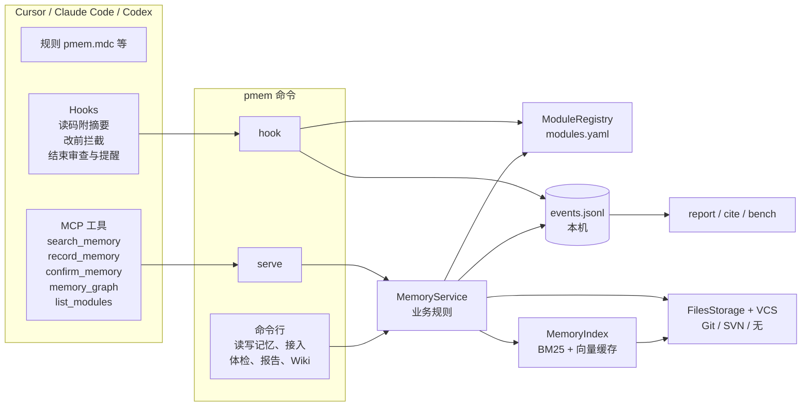

# pmem 架构

本文是 v0.1 实现之后提炼出的最小架构。完整的设计过程见 `docs/superpowers/specs/`。

## 设计原则

1. **记忆就是仓库里的文件。** `.memory/entries/<模块>/<ULID>.md` 随代码提交、评审、回滚；没有服务器和数据库，检索索引只是本机缓存，删掉可以重建。
2. **按业务模块寻址。** 地址是 `category.Module` 加模块内议题 `entity`。`modules.yaml` 把多个路径和别名映射到同一个模块，所以“按文件查”和“按名字查”结果一致。
3. **写入后不可变。** 推翻旧结论时新写一条，在 `supersedes` 里引用旧条目，替代关系在索引里推导。例外有两个：同一作者、尚未提交的条目可以用 `draft_id` 覆盖，避免同一任务写出重复记忆；`confirm_memory` 会改写条目头部的 `verified`（核对日期），正文不动，多人同一天核对同一条时可能出现一行的合并冲突，保留较新的日期即可。
4. **Agent 主动为主，Hooks 兜底。** 规则告诉 Agent 何时查、何时写；Hooks 只在它漏掉时提醒一次，并且出任何错误都直接放行，绝不卡住开发。
5. **收益要能量化。** 每次检索、写入、提醒都会在本机留下事件，用 `pmem report` 汇总；严格对比用 `pmem bench`。

## 组件



| 包 | 职责 |
|---|---|
| `core` | 条目模型（Markdown + YAML 头，不认识的顶层字段原样写回）及共用常量（类型中文名、可见状态）、ULID（生成、校验、取生成时间）、配置（YAML 写错、`secret_patterns` 不是合法正则时统一报 `ConfigError`）、模块目录（名称解析、别名、路径映射；`paths` 写成字符串、模块名不带大类时报 `RegistryError`）、敏感信息检测 |
| `catalog` | `modules.yaml` 的维护，不依赖 `cli`：读写（保留文件头注释、统一 LF）、rename / merge / split / deprecate / move 的规划与记忆搬家、`sync` 规划（只追加，不覆盖任何已有模块，含已废弃的）、覆盖率统计（`map_files` 把代码文件映射到模块，`module_heat` 把文件热度汇总到模块，`sync`、`seed`、`report` 共用）；`cli` 只解析参数、渲染输出，`metrics`、`doctor` 直接用它 |
| `vcs` / `storage` | 作者与版本号来自 Git/SVN；提交历史（`commits_since`，热度扫描用）也由各适配器提供，新增版本库类型只需加一个适配器；写文件；判断条目是否已有提交记录（决定能否 `draft_id` 覆盖：确认、归档改写过的已提交记忆仍不能覆盖）；按路径查改动时分批调用（Windows 命令行约 32K 字符上限）；SVN 下自动 `svn add`，`pmem migrate` 搬文件时已纳入版本库的用 `svn mv` 保留历史 |
| `index` | 分词（中文二元组 + 英文词 + camelCase 拆分）、BM25、嵌入器（ONNX / Ollama / OpenAI 兼容）、SQLite 向量缓存（第一次读写向量时才打开，只用关键词检索时不建库）、混合排序、按关联代码核对过期（检索、图谱、Hook、Wiki 共用）、记忆图谱 |
| `service` | 五个 MCP 工具背后的规则：长度、类型、密钥、每日上限、新模块提示、检索参数归一、同义词扩展；模块和存储错误统一转成 `ok: false` 返回，被拒绝的写入记 `record_rejected` 事件；状态变更（`change_status`：archive / restore / accept / reject）只开放给命令行，归档时在 YAML 头记下日期、原状态和归档人（`archived: {on, from, by}`），供 `as_of` 回看与恢复；废弃模块（`status: deprecated`）拒绝写入；MCP 与 CLI 共用。按职责分文件：`base`（依赖懒加载、错误返回形状、共用小工具）、`search`（检索、图谱、模块列表，只读）、`record`（写入规则）、`status`（核对、归档、种子转正）、`curation`（高频词、可合并议题）；`MemoryService` 由各 `*Ops` 组合而成，新增一类操作加一个文件即可 |
| `server` | MCP stdio 服务，只做参数转发：工具调用加锁串行执行（框架在线程池里并发跑同步工具），任何异常都转成带 `"server": "pmem"` 的 `ok: false`，配置写错时每次调用返回具体原因、改好即恢复；`config.yaml` 改动（按修改时间和大小判断）后下一次调用重建服务，新配置即时生效，只有 `server.*` 由看门狗在启动时读取、要重启服务；`pmem serve` 默认先起看门狗（`server/watchdog.py`，不导入 mcp 和服务层），真正的服务跑在 `serve --worker` 子进程里。子进程崩溃、单次调用超过 `server.request_timeout`（默认 120 秒，每超时一次放宽一倍、最多 8 倍，有调用成功即恢复）或 pmem 代码更新时换新子进程，并用缓存的 `initialize` 替客户端重新握手，客户端连接不断；进行中的调用返回错误提示重试，连续失败按 0/1/2/5/10/30 秒退避，退避期间的调用直接返回错误并提示改用终端 `pmem search`。重启记 `server_restart` 事件，进 `pmem health` |
| `hooks` | Hook 输入解析（兼容 Windows 转码，提问原文从对话记录读取）、按对话隔离的状态（读改写加文件锁，并行的 Hook 进程不会互相覆盖；摘要里的“需核实”在释放锁之后才核对，避免并行的 Hook 排队等版本库查询）、终端命令解析（`hooks/shell.py`：写到哪些文件、是否在跑脚本、命令里的 pmem 调用）、记忆审查、闸门与结束提醒；事件有 prompt、pre-tool、after-mcp、edited、post-tool、compact、stop（before-mcp 只为兼容旧配置保留，直接放行） |
| `metrics` | 事件日志（`events.py`，多进程追加时加跨进程锁）、收益报告、引用识别、健康报告（`pmem health`，含按议题找“一正一反、用词高度相似”的疑似矛盾记忆，被拒写入按错误码归类，改了代码却没写功能记录的模块，严格的清理候选 `cleanup.py`，未登记模块的转正提示与召回审计 `audit.py`）、记忆图自检（`memmap.py`：漏记、断链、悬而未决、过期与总评；渲染交给 `generate.memmap`，由 `cli/map_cmd.py` 拼起来，因为 `metrics` 不能依赖 `generate`） |
| `importers` | 从既有记忆系统（LanceDB 参考实现）只读导入：复制后再读、按来源 id 幂等、保留原时间、套用项目的敏感信息规则 |
| `bench` | 基于 Cursor SDK 的有/无记忆对照实验 |
| `generate` | `templates`（规则、技能、Hook、配置模板）、`integrations`（按 Agent 写入规则和技能，合并 hooks / MCP 配置时只替换 pmem 自己的条目）、`wiki`（模块页附 Mermaid 演化图）、`memmap`（`pmem map` 的本地 HTML 与 Mermaid；图的数据由 `index/memmap.py` 从记忆文件推出） |
| `cli` / `scan` | 命令入口（两张分发表：search、record、confirm、graph、list、terms、archive 直接调 `MemoryService`；init、scan、sync、doctor、compact、anchors、format、import、reindex、report、health、seed、migrate、wiki、map、bench、serve、hook 各自实现；`compact --undo` 调 `MemoryService.revert` 撤销合并；代码搬家后 `anchors --rename 旧=新` 改写所有记忆的关联代码；`init_cmd` 只建配置和打印结果，接入文件交给 `generate.integrations`）、目录与提交热度扫描（供 Agent 划分模块；`sync` 读一次提交历史同时算 180 天热度和 90 天是否有改动）、代码文件索引（`scan/files.py`，`anchors` 补关联代码和清理候选共用） |

## 分层

依赖只能朝下，由 `tests/test_layering.py` 检查，新增包或新依赖要先在那里登记：

| 层 | 包 | 可以依赖 |
|---|---|---|
| 入口 | `cli` | 任何包；其他包都不能导入 `cli` |
| 汇总 | `metrics`（report、health）、`bench` | 下面各层；report、health 可以用 `service` |
| 接入 | `server`、`hooks` | `service`（只有 server）、`index`（只有 hooks，且不碰 `index.store`，Hook 进程不加载 numpy）、`core`、`vcs` |
| 服务 | `service` | `index`、`generate`（写入后自动更新 Wiki）、`storage`、`vcs`、`core` |
| 领域 | `index`、`catalog`、`generate`、`importers`、`scan` | `storage`、`vcs`、`core`；`catalog` 还可用 `scan`，`generate` 还可用 `index`，`importers` 还可用 `catalog` |
| 底层 | `storage`、`vcs`、`core`、`metrics.events` | `core`（`storage` 还可用 `vcs`）；`metrics.events` 是谁都能写的事件日志，单独算一层 |

## 五条主流程

**检索**：Agent 调用 `search_memory(path=...)`。服务先用 `modules.yaml` 把路径映射到模块，查询词按同义词表和记忆的 `aliases` 扩展，再在该模块内排序：相关度 = 0.6 × 向量相似度 + 0.4 × BM25；议题匹配加 0.15；按路径检索时锚点就是该文件的加 0.3、同目录的加 0.1（只传路径时相关度为 0，没有这项加分就只剩新旧决定顺序）；排除项和更正加 0.05；再乘时间系数 0.7 + 0.3 × 0.5^(天数/90)（越新越靠前，最旧也保留七成，核对过的按核对日期算）；同一批次（同一对话，或同一作者 90 分钟内）最多返回 2 条。命中议题为空时退回到整个模块，并标注 `fallback: module`。锚点代码变化过的条目带 `stale: true`，核对后用 `confirm_memory` 刷新核对日期。锚点写成 `路径#函数名` 时，Git 下取基准日（核对日期，7 天内提交的记忆取提交日）那版文件，只比较该函数的代码块（Python 按缩进，其他语言按花括号），同文件其他地方改了不算；SVN、没有历史或找不到函数时退回按文件判断。Git 下核对结果跨进程缓存：当前提交、日期和记忆目录以外的未提交文件都没变时，Hook、命令行和 Wiki 直接复用，只核对新增或改过的记忆。带 `as_of` 时只看那天有效的记忆。

**写入**：`record_memory` 依次校验模块、类型、长度、密钥、每日上限，然后写文件、刷新索引，返回 `draft_id`、同模块同议题最相近的已有记忆（`similar`，只用关键词排序，不加载语义模型）和写作提示。Hook 在调用前注入对话 id 和本对话上一次的 `draft_id`，同一任务再写时会覆盖，而不是新增。覆盖时没传的 `supersedes`、`anchors`、`aliases` 沿用原值（MCP 传空列表也算没传，因为模型常顺手填 `[]`；命令行只写参数名不跟值表示清空），闸门此时也不再自动补锚点，避免替代关系丢失、旧记忆悄悄恢复现行。`memory_graph(module=...)` 给出模块全貌：每个议题的最新两条结论、相关模块；带 `entity` 时看该议题的替代时间线。现行记忆同样按关联代码核对，带 `stale`/`check`。Wiki 把同样的内容生成每模块一页的 Markdown，过期的标“需核实”；写入或确认记忆后自动重新生成（`wiki.auto`，约 0.5 秒，失败只附提醒不影响写入），也可手动 `pmem wiki`。目录里自带 `.gitignore`，默认不进版本库。

**审查**：不改代码的问答也要对照记忆。三层，各模块每个对话只触发一次：

- 提问时：Claude Code 的 UserPromptSubmit 直接附上问题提到的模块的摘要；Cursor 的 beforeSubmitPrompt 不能注入内容，只记下提到了哪些模块。
- 读代码时（postToolUse，匹配 Read、Grep、Glob、语义搜索；搜索类只在限定到某个模块的文件或目录时生效）：附上该模块的现行结论摘要（按排除项、风险、更正、决定、结论排序，每议题最多 2 条，共 6 条；锚点就是正在看的文件的记忆先占至多 3 个名额），关联代码之后改过的标“需核实”。
- 回合结束时：从对话记录取本轮提问和本轮 Agent 用读代码、搜索工具看过的路径，涉及的模块有记忆、本轮却既没查也没看过摘要（例如 Hook 没覆盖到的工具、旧版 hooks.json），就用 `followup_message` 要求 Agent 查过后核对回答；中断结束和已追问过的回合不再追问。

`gate.question_review`、`gate.read_digest` 可分别关闭。“跳过记忆”只在作为独立短语出现时生效，“如何避免跳过记忆”这类说法不算；生效后第一次读代码会告诉 Agent 记忆已关闭及触发它的原话，说“恢复记忆”（`gate.resume_markers`）可撤销。

**闸门**：preToolUse 拦截写文件的工具和终端里的写命令（重定向（含 `1>`、`2>`、`&>`、`*>` 和带引号的目标）、PowerShell 写文件命令、sed -i、tee/Tee-Object、删除、cp/mv/Copy-Item/Move-Item、git checkout/restore/rm/mv/apply、`[IO.File]::WriteAllText`，套一层的 `powershell -Command`/`-File`、`cmd /c`、`bash -c` 和直接运行的 .ps1/.bat/.sh，以及 python/node 内联代码和所运行脚本里写文件时出现的字面路径），把目标路径映射到模块；命令名去掉路径和 `.exe`（`/bin/rm`、`rm.exe` 都按 rm 认），`sed -i`、`Remove-Item a, b` 这类一次改多个文件的取全部目标；目标是目录时（`rm -rf`），登记在它下面的各个模块都要查过。命令里先 `cd`/`Set-Location` 再写相对路径时按切换后的目录算；here-string 和 heredoc 的正文当作数据，不当作命令。同一条命令里先 `pmem search` 再写，只放行查过的那个模块。如果该模块已有现行记忆（被替代、停用的不算）、本对话还没查过：`warn` 档拒绝一次，并在 `user_message` 里写明该调用什么，同时列出该模块现行的排除项、风险和更正（最多 5 条，弥补检索关键词没对上的情况）；`block` 档一直拒绝，直到查过为止。“已查过”要求检索真正返回了结果：MCP 检索在 afterMCPExecution（Claude Code、Codex 为 PostToolUse）拿到 `ok: true` 后才登记，调用失败不算；终端里的 `pmem search --module <模块>`（模块名要写字面值）执行前只记为待确认，执行完、输出里看得到该模块才登记（Cursor 的 postToolUse 带 `tool_output`，Claude Code、Codex 带 `tool_response`；拿不到输出时按执行完算）；输出被丢弃（`> $null`、`| Out-Null`、重定向到文件）或写在 `||` 之后（前一条成功就不会执行）时不算。同一条命令里先查再写仍放行查过的模块，因为命令本身就带着检索。脚本、内联代码、变量拼出来的路径，以及不认识的程序（格式化工具、`git stash`/`reset`、`patch` 等；只读命令和已认出目标的写命令除外）事前看不出写了什么：执行前后各取一次未提交文件快照（Git 用 `git ls-files -m -d -o`，每次约 40 毫秒；SVN 用 `svn status --xml`），比对出命令实际改了哪些文件，记为已编辑；改到没查过的模块时用 postToolUse 的 `additional_context` 立即提醒补查（事后提醒，拦不住）。快照按命令分开存，并行命令互不覆盖；同一时段内编辑工具改过的文件不算到命令头上；单次快照超过 1 秒时（超大仓库）暂停快照 24 小时，执行前就慢的那次直接放弃比对，不再让执行后再等一遍；`git`、`svn` 的只读子命令（status、log、diff 等）不做比对。SVN 的未提交文件清单要遍历整个工作副本，所以只给闸门比对用，不用来算过期核对缓存的指纹。上下文压缩后状态清零。stop 时提醒一次：改了模块却没写记忆；或整个对话只查了记忆、没改也没写（`gate.analysis_reminder`）。中断结束的回合和说了“跳过记忆”的对话不提醒。

**标题、全项目级坑与去重**：记忆可带 `summary`（一句话标题，没填时取正文第一句、去掉“决定：”这类前缀自动生成）、`scope: project`（全项目都会踩的坑）、`verify`（怎么验证）。读代码摘要、拦截提示、Wiki 只显示标题；读任何模块时附上本对话还没给过的至多 3 条全项目级排除项、风险、更正。同一对话里检索到已给过全文的记忆只返回标题，`full=true`（命令行 `--full`）取全文；读代码摘要只给标题，不计入去重。

**教训与功能记录分层**：类型分两层。教训（`exclusion`、`risk`、`correction`、`decision`、`conclusion`，`core/entry.py` 的 `LESSON_KINDS`）和功能记录（`feature`、`plan`，`RECORD_KINDS`）放在同一模块目录、靠类型区分，不分物理目录。`MemoryIndex.search` 带 `feature_limit` 时两层各自排序：`items` 只放教训全文，`features` 只放功能记录标题（`title_row`），默认 3 条，所以功能记录再多也挤不掉教训；`search(ids=[...])` 按 id 取全文。读代码摘要（`graph.digest`）只从教训里挑，末尾附至多 2 条锚点就是当前文件的功能记录（`file_features`）；拦截提示同样列出目标文件上的功能记录。结束提醒按模块要求功能记录，只改了 `gate.record_exempt` 里文件的模块不提醒；stop 事件记下 `required`（需要记录的模块），`pmem report` 据此算功能记录覆盖率。可选字段 `applies` 写适用条件，参与检索文本，结果里出现时附 `applies_hint`。

**度量**：服务和 Hooks 把事件追加到用户缓存目录的 `events.jsonl`。`pmem report` 按对话聚合；“记忆被采用”在报告时离线比对对话记录，不在 Hook 里计算。

## 存储布局

```text
<仓库>/.memory/                      # 提交到版本库
  config.yaml                        # 闸门、写入限制、嵌入后端
  modules.yaml                       # 模块目录
  entries/<category.Module>/<ULID>.md

<用户缓存>/pmem/                     # Windows: %LOCALAPPDATA%\pmem，可用 PMEM_CACHE_DIR 改
  models/                            # 语义模型，所有项目共享
  parsed/                            # config.yaml、modules.yaml 的解析结果（按修改时间失效，Hook 免导入 yaml）
  <项目名>-<路径哈希>/
    vectors.db                       # 向量缓存（按嵌入器 + 内容哈希；用到语义检索才创建）
    anchors.json                     # 过期核对结果（提交号或未提交文件变化即失效，10 分钟过期）
    sessions/<对话>.json             # 闸门状态，7 天过期
    seen/<对话>.txt                  # 对话内去重：已返回过全文的记忆 id，压缩后清空，7 天过期
    seen/cli-handoff.json            # 终端 pmem search 的对话 id 交接（Hook 执行前写，120 秒内按模块认领）
    events.jsonl  cites.json         # 收益统计（events.lock 是追加事件时的跨进程锁）
    hooks.log  hook-errors.log
```

## 关键取舍与证据

| 决定 | 原因 |
|---|---|
| 关键词检索用自研中文二元组 BM25，不用 SQLite FTS5 trigram | trigram 匹配不到两个字的中文词 |
| 默认语义模型 bge-small-zh-v1.5（ONNX，约 90 MB），按需加载 | 在 `tests/fixtures/eval` 上效果足够、体积小；首次调用才加载，避免 MCP 启动卡住约 30 秒 |
| 闸门指引写在 `user_message` | Cursor 3.9 实测拒绝时只把 `user_message` 交给 Agent，`agent_message` 不会送达 |
| Hook 只依赖 ASCII 字段，输出纯 ASCII | Windows 中文代码页下 Cursor 会把 Hook 输入按 GBK 误解码，JSON 常被破坏 |
| Cursor 下的问答审查放在 stop 追问 | Cursor 的 beforeSubmitPrompt 只能放行或拦截，sessionStart 只在新对话触发一次；能每轮生效的只有 postToolUse 的 `additional_context` 和 stop 的 `followup_message`（读码摘要已实测送达） |
| `warn` 只拒绝一次 | 不打断节奏；Agent 并行发出的多个编辑实际逐个执行，只有第一个被拒，需要重做的只有那一处 |
| 引用识别只看字面重合（阈值 0.15） | 语义相似度在长对话里取最大值后，无关对话也能到 0.8，区分不开；字面重合在无关对话中不超过 0.11 |
| bench 两组都不加载项目设置 | 只比较“记忆内容”的价值，排除规则、Hooks 等其他变量 |

这些结论在本仓库的 `.memory/entries/` 中都有对应条目，包含证据和影响范围。

## 已知限制

- Cursor 传给 Hook 的 MCP 工具名不带服务名，别的记忆服务也叫 `search_memory`。pmem 的 MCP 返回统一带 `"server": "pmem"`，闸门只认带标记的结果（或工具名里有 pmem、或返回了本仓库的记忆），别家同名工具不算查过；但调用前分不出来，参数仍会注入给它（实测无害）。升级后没重启的旧版 MCP 服务返回空结果时也不算查过，可改用终端 `pmem search`（带看门狗的版本升级后会自动换新代码；从旧版升级上来的第一次仍需在 Cursor 里重启一次 MCP）。
- 看门狗管不到它自己：Cursor 那边把 MCP 标成出错（如启动时 `pmem` 命令找不到）后不会自动重连，需要在 Cursor 设置里重新打开；看门狗也判断不了“慢”和“卡死”，只按超时处理。
- 收益报告只看本机数据，团队汇总尚未实现。
- `pmem bench` 还没有用真实 API Key 跑过完整对照；示例用例已用 `--dry-run` 验证有效。
- 模块划分依赖 Agent 按 `pmem-bootstrap` 技能完成：`pmem scan` 只给出目录和提交热度，不会自动划分。
- Claude Code、Codex 的接入只做过模拟测试，还没在真实会话里跑过。
