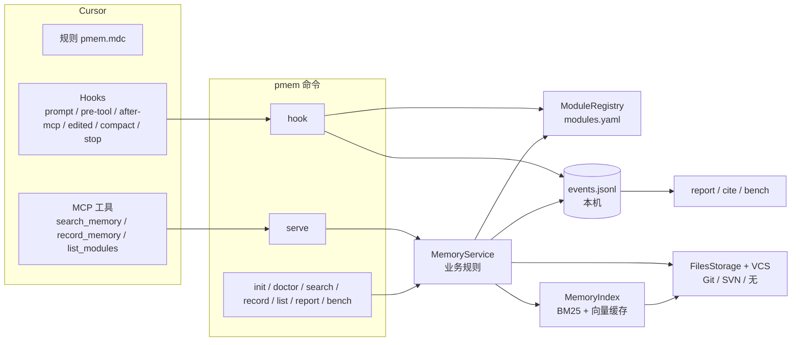

# pmem 架构

本文是 v0.1 实现之后提炼出的最小架构。完整的设计过程见 `docs/superpowers/specs/`。

## 设计原则

1. **记忆就是仓库里的文件。** `.memory/entries/<模块>/<ULID>.md` 随代码提交、评审、回滚；没有服务器和数据库，检索索引只是本机缓存，删掉可以重建。
2. **按业务模块寻址。** 地址是 `category.Module` 加模块内议题 `entity`。`modules.yaml` 把多个路径和别名映射到同一个模块，所以“按文件查”和“按名字查”结果一致。
3. **写入后不可变。** 推翻旧结论时新写一条，在 `supersedes` 里引用旧条目，替代关系在索引里推导。唯一的例外是：同一作者、尚未提交的条目可以用 `draft_id` 覆盖，避免同一任务写出重复记忆。
4. **Agent 主动为主，Hooks 兜底。** 规则告诉 Agent 何时查、何时写；Hooks 只在它漏掉时提醒一次，并且出任何错误都直接放行，绝不卡住开发。
5. **收益要能量化。** 每次检索、写入、提醒都会在本机留下事件，用 `pmem report` 汇总；严格对比用 `pmem bench`。

## 组件



| 包 | 职责 |
|---|---|
| `core` | 条目模型（Markdown + YAML 头）、ULID、配置、模块目录（名称解析、别名、路径映射）、敏感信息检测 |
| `vcs` / `storage` | 作者与版本号来自 Git/SVN；写文件；判断条目是否已提交（决定能否 `draft_id` 覆盖）；SVN 下自动 `svn add` |
| `index` | 分词（中文二元组 + 英文词 + camelCase 拆分）、BM25、嵌入器（ONNX / Ollama / OpenAI 兼容）、SQLite 向量缓存、混合排序 |
| `service` | 三个工具背后的规则：长度、类型、密钥、每日上限、新模块提示、检索参数归一；MCP 与 CLI 共用 |
| `server` | MCP stdio 服务，只做参数转发 |
| `hooks` | Hook 输入解析（兼容 Windows 转码）、按对话隔离的状态、闸门与结束提醒 |
| `metrics` | 事件日志、收益报告、引用识别 |
| `bench` | 基于 Cursor SDK 的有/无记忆对照实验 |
| `cli` / `generate` / `scan` | 命令入口、`init` 生成的文件模板、目录与提交热度扫描（供 Agent 划分模块） |

## 四条主流程

**检索**：Agent 调用 `search_memory(path=...)`。服务先用 `modules.yaml` 把路径映射到模块，再在该模块内排序：相关度 = 0.6 × 向量相似度 + 0.4 × BM25；议题匹配加 0.15；排除项和更正加 0.05；按 90 天半衰期衰减；同一批次（同一对话，或同一作者 90 分钟内）最多返回 2 条。命中议题为空时退回到整个模块，并标注 `fallback: module`。锚点代码变化过的条目带 `stale: true`。

**写入**：`record_memory` 依次校验模块、类型、长度、密钥、每日上限，然后写文件、刷新索引，返回 `draft_id`。Hook 在调用前注入对话 id 和本对话上一次的 `draft_id`，同一任务再写时会覆盖，而不是新增。

**闸门**：preToolUse 拦截写文件的工具和终端里的写命令，把目标路径映射到模块。如果该模块已有记忆、本对话还没查过：`warn` 档拒绝一次，并在 `user_message` 里写明该调用什么；`block` 档一直拒绝，直到查过为止。MCP 检索、终端里的 `pmem search` 都算“已查过”。上下文压缩后状态清零。stop 时，对“改了却没写记忆”的模块提醒一次。

**度量**：服务和 Hooks 把事件追加到用户缓存目录的 `events.jsonl`。`pmem report` 按对话聚合；“记忆被采用”在报告时离线比对对话记录，不在 Hook 里计算。

## 存储布局

```text
<仓库>/.memory/                      # 提交到版本库
  config.yaml                        # 闸门、写入限制、嵌入后端
  modules.yaml                       # 模块目录
  entries/<category.Module>/<ULID>.md

<用户缓存>/pmem/                     # Windows: %LOCALAPPDATA%\pmem，可用 PMEM_CACHE_DIR 改
  models/                            # 语义模型，所有项目共享
  <项目名>-<路径哈希>/
    vectors.db                       # 向量缓存（按嵌入器 + 内容哈希）
    sessions/<对话>.json             # 闸门状态，7 天过期
    events.jsonl  cites.json         # 收益统计
    hooks.log  hook-errors.log
```

## 关键取舍与证据

| 决定 | 原因 |
|---|---|
| 关键词检索用自研中文二元组 BM25，不用 SQLite FTS5 trigram | trigram 匹配不到两个字的中文词 |
| 默认语义模型 bge-small-zh-v1.5（ONNX，约 90 MB），按需加载 | 在 `tests/fixtures/eval` 上效果足够、体积小；首次调用才加载，避免 MCP 启动卡住约 30 秒 |
| 闸门指引写在 `user_message` | Cursor 3.9 实测拒绝时只把 `user_message` 交给 Agent，`agent_message` 不会送达 |
| Hook 只依赖 ASCII 字段，输出纯 ASCII | Windows 中文代码页下 Cursor 会把 Hook 输入按 GBK 误解码，JSON 常被破坏 |
| `warn` 只拒绝一次 | 不打断节奏；Agent 并行发出的多个编辑实际逐个执行，只有第一个被拒，需要重做的只有那一处 |
| 引用识别只看字面重合（阈值 0.15） | 语义相似度在长对话里取最大值后，无关对话也能到 0.8，区分不开；字面重合在无关对话中不超过 0.11 |
| bench 两组都不加载项目设置 | 只比较“记忆内容”的价值，排除规则、Hooks 等其他变量 |

这些结论在本仓库的 `.memory/entries/` 中都有对应条目，包含证据和影响范围。

## 已知限制

- MCP 路径下，Hook 是否真能把对话 id 注入工具参数还没在 Cursor 中实测；作为兜底，报告会从 afterMCPExecution 的结果里提取记忆 id。
- 收益报告只看本机数据，团队汇总尚未实现。
- `pmem bench` 还没有用真实 API Key 跑过完整对照；示例用例已用 `--dry-run` 验证有效。
- 模块划分依赖 Agent 按 `pmem-bootstrap` 技能完成；完整的自动扫描器、重建索引、批量导入还在计划中。
